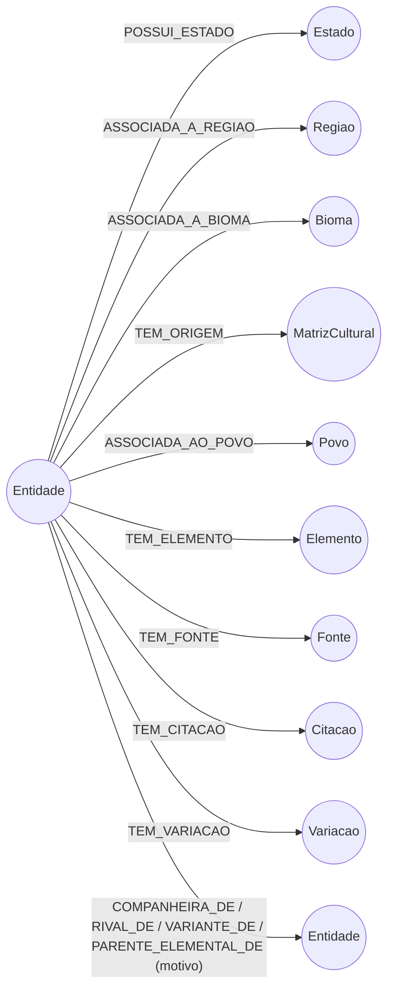

# Folclore Paraibano — Mini-Projeto 4 (grafo de propriedades no Memgraph)

A base de conhecimento do Mini-Projeto 3 (entidades do folclore com ligação à
Paraíba, coletadas da API Encantaria Digital) refeita como **grafo de
propriedades**, persistida no **Memgraph** (Docker) e consultada com **Cypher**.

## Conteúdo do repositório

| Arquivo | Função |
|---|---|
| `docker-compose.yml` | Sobe o Memgraph (Bolt 7687) e o Memgraph Lab (3000), com volume `mg_lib` |
| `carga.py` | Cria a base no Memgraph a partir do zero e confere as contagens |
| `consultas.py` | Executa as consultas Cypher (18 do MP3 reescritas + 6 travessias) e imprime cada resultado |
| `dados/entidades_paraiba_completo.json` | Dados coletados (mesma fonte do MP3) |
| `requirements.txt` | Dependência Python (`neo4j`) |

## Modelo do grafo

### Nós (rótulos)

| Rótulo | Qtde | Propriedades |
|---|---|---|
| `:Entidade` + tipo (`:Assombracao` 14, `:Encantado` 7, `:Guardiao` 6, `:Metamorfo` 2, `:Maldicao` 2, `:Origem` 1) | 32 | `slug` (único), `nome`, `descricao`, `tagline`, `causoCompleto`, `classificacao`, `nivelAmeaca`, `raridade`, `confianca`, `origemIncerta`, `cultoVivo`, `referencia` (`false`) |
| `:Entidade:Referencia` | 46 | `slug`, `nome`, `referencia` (`true`) — entidades citadas nas relações, sem ficha completa |
| `:Estado` | 21 | `sigla` |
| `:Regiao` | 5 | `nome` |
| `:Bioma` | 5 | `id` |
| `:MatrizCultural` | 4 | `id` |
| `:Povo` | 5 | `id` |
| `:Elemento` | 5 | `id` |
| `:Fonte` | 59 | `id`, `tipo`, `ref`, `licenca` |
| `:Citacao` | 49 | `id`, `texto`, `autor`, `obra`, `ano` |
| `:Variacao` | 81 | `id`, `registro`, `nomeLocal`, `localidade`, `estadoUf`, `confianca` |

Total: **312 nós**.

### Relacionamentos

| Relacionamento | Origem → Destino | Propriedades |
|---|---|---|
| `POSSUI_ESTADO` | Entidade → Estado | — |
| `ASSOCIADA_A_REGIAO` | Entidade → Regiao | `principal` |
| `ASSOCIADA_A_BIOMA` | Entidade → Bioma | `principal` |
| `TEM_ORIGEM` | Entidade → MatrizCultural | — |
| `ASSOCIADA_AO_POVO` | Entidade → Povo | — |
| `TEM_ELEMENTO` | Entidade → Elemento | `papel` (`primario` ou `secundario`) |
| `TEM_FONTE` / `TEM_CITACAO` / `TEM_VARIACAO` | Entidade → Fonte / Citacao / Variacao | — |
| `COMPANHEIRA_DE` (39), `PARENTE_ELEMENTAL_DE` (30), `VARIANTE_DE` (18), `RIVAL_DE` (8) | Entidade → Entidade (completa ou referência) | `motivo` |

Total: **669 relacionamentos** (95 deles entre entidades, igual ao MP3).



### O que mudou em relação ao RDF/OWL do MP3

| No MP3 (RDF/OWL) | No grafo de propriedades |
|---|---|
| Subclasses (`Assombracao`, `Encantado`...) | Segundo rótulo no nó (`:Entidade:Assombracao`) |
| `RelacaoEntreEntidades` (nó reificado com origem, destino, tipo e motivo) | Relacionamento direto com a propriedade `motivo`; o `tipo` virou o próprio tipo do relacionamento |
| Propriedades de dados (`possuiNome`...) | Propriedades do nó |
| `associadaABiomaPrincipal` (predicado extra) | Propriedade `principal` no relacionamento |
| `owl:hasKey` / `FunctionalProperty` em `slug` | Constraint de unicidade em `Entidade.slug` (e nos demais identificadores) |
| 46 referências externas (só tipo, slug e nome) | Nós `:Entidade:Referencia` |

## Como executar

Pré-requisitos: Docker (Desktop ou Engine com Compose) e Python 3.9+.

```bash
# 1. Subir o Memgraph e o Lab
docker compose up -d
docker compose ps            # deve mostrar memgraph e memgraph-lab em execução

# 2. Instalar a dependência Python
python -m venv .venv
source .venv/bin/activate    # Windows (PowerShell): .venv\Scripts\Activate.ps1
pip install -r requirements.txt

# 3. Carregar a base (apaga e recria tudo; pode rodar mais de uma vez)
python carga.py

# 4. Executar todas as consultas
python consultas.py
```

Ao final do passo 3 o script imprime uma tabela comparando as contagens do JSON
com as do Memgraph (todas devem coincidir) e o total de nós (**312**).

Visualização: abra o Memgraph Lab em <http://localhost:3000> e execute, por
exemplo, `MATCH (e:Entidade)-[r]->(x) RETURN e, r, x LIMIT 100;`.

## Teste de persistência

O volume `mg_lib` guarda snapshots e logs de escrita do Memgraph fora do container.

```bash
# antes
echo "MATCH (n) RETURN count(n);" | docker exec -i memgraph mgconsole     # 312

docker compose restart memgraph

# depois (aguarde alguns segundos): deve devolver o mesmo valor
echo "MATCH (n) RETURN count(n);" | docker exec -i memgraph mgconsole     # 312
```

(Também dá para rodar `MATCH (n) RETURN count(n);` no Lab antes e depois.)

> **Atenção:** `docker compose down` preserva o volume; `docker compose down -v`
> o remove e **apaga a base** (basta rodar `python carga.py` de novo).

## Consultas (`consultas.py`)

Todas as 18 consultas do MP3 (7 do rdflib e 11 de SPARQL) foram reescritas em
Cypher, mais 6 travessias. Como a consulta 6 do rdflib é impressa em dois blocos
(propriedades e relacionamentos), a execução mostra 25 blocos numerados:
`CONSULTA n [origem]`, o propósito e o resultado.

| Nº impresso | Origem (MP3) | O que faz |
|---|---|---|
| 1 a 8 | rdflib 1 a 7 | Entidades (32), da Paraíba, da Caatinga, rivais, citações, tudo sobre a Mula Sem Cabeça (blocos 6 e 7: propriedades e relacionamentos), tudo que aponta para a Caatinga por tipo de relacionamento |
| 9 a 12 | SPARQL 1 a 4 | Classificações, filtro por ameaça baixa, ordem decrescente, contagem por classificação |
| 13, 14, 19 | SPARQL 5, 6, 11 (ASK) | Aipó e Tambiá na Paraíba (`true`), existe entidade na Caatinga (`true`), Aipó e Tambiá no RS (`false`) |
| 15 | SPARQL 7 (CONSTRUCT) | Subgrafo reduzido: nome e estado das entidades da Paraíba |
| 16 a 18 | SPARQL 8 a 10 (INSERT, DELETE/INSERT, DELETE) | `MERGE`, `SET`, `DETACH DELETE` em uma entidade temporária; o total de nós é impresso antes, depois da inserção e depois da remoção |
| 20 a 25 | novas | Travessias (abaixo) |

**Consultas com travessia (2+ relacionamentos encadeados)**

| Travessia | Padrão |
|---|---|
| 1 | Pares companheiros da mesma referência: `(a)-[:COMPANHEIRA_DE]->(ref)<-[:COMPANHEIRA_DE]-(b)` |
| 2 | Companheira de companheira: `(a)-[:COMPANHEIRA_DE]->(b)-[:COMPANHEIRA_DE]->(c)` |
| 3 | Fontes das companheiras: `(a)-[:COMPANHEIRA_DE]->(b)-[:TEM_FONTE]->(f)` |
| 4 | Rivais no mesmo bioma: `RIVAL_DE` + `ASSOCIADA_A_BIOMA` duas vezes para o mesmo `Bioma` |
| 5 | Mesmo povo e mesmo elemento: `ASSOCIADA_AO_POVO` e `TEM_ELEMENTO` compartilhados |
| 6 | Caminho mais curto entre duas lendas, com caminho de tamanho variável (`*1..6`) |

## Solução de problemas

- **`ServiceUnavailable` / conexão recusada:** o Memgraph ainda está subindo ou o
  container não está rodando; confira com `docker compose ps` e tente de novo.
- **Porta ocupada:** feche o que usa 7687, 7444 ou 3000, ou ajuste as portas no `docker-compose.yml`.
