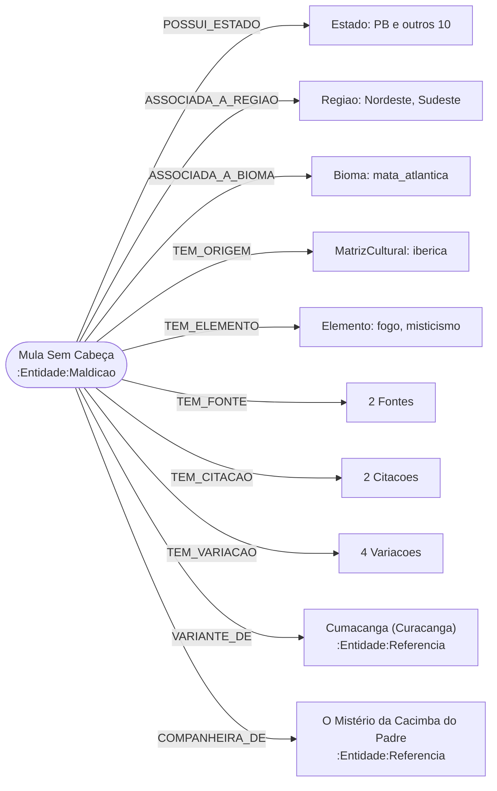

# Folclore Paraibano em grafo (Memgraph + Cypher)

Um banco de grafos com **32 lendas do folclore brasileiro ligadas à Paraíba**, como a Mula Sem Cabeça, o Boi Espácio e a Lagoa Encantada potiguara. Os dados ficam no [Memgraph](https://memgraph.com/), que roda em Docker, e são consultados com **Cypher**, a linguagem de consulta de grafos.

Este projeto é a continuação do Mini-Projeto 3, em que a mesma base era uma ontologia RDF/OWL consultada com SPARQL. Aqui ela foi remodelada como **grafo de propriedades**.

## A base de dados em um minuto

**De onde vêm os dados.** Da API do folclore brasileiro Encantaria Digital. As lendas associadas à Paraíba foram coletadas e guardadas em um arquivo JSON (`dados/entidades_paraiba_completo.json`). O script de carga lê esse arquivo e cria o grafo.

**O que tem nela.** Cada lenda é uma *entidade* folclórica, de um de seis tipos:

| Tipo | Quantidade |
|---|---|
| Assombração | 14 |
| Encantado | 7 |
| Guardião | 6 |
| Metamorfo | 2 |
| Maldição | 2 |
| Origem | 1 |

Cada entidade tem uma ficha completa: nome, causo (a história), nível de ameaça, raridade, estados onde aparece, biomas, povo de origem, elementos, fontes bibliográficas, citações e variações regionais da lenda.

**Um exemplo real: a Mula Sem Cabeça.**

| Campo | Valor |
|---|---|
| Tipo | Maldição |
| Nível de ameaça e raridade | alto, épico |
| Estados | 11 (entre eles PB, PE, RN e CE) |
| Bioma e regiões | Mata Atlântica; Nordeste e Sudeste |
| Matriz cultural e elementos | ibérica; fogo e misticismo |
| Fontes, citações e variações | 2, 2 e 4 |
| Relações com outras lendas | variante da Cumacanga, companheira de "O Mistério da Cacimba do Padre" |

**As "referências".** As relações das fichas citam outras 46 lendas que não têm ficha completa na base (só o nome). Elas entram no grafo como nós de *referência*, para que nenhuma relação fique sem destino.

No total, o grafo tem **312 nós e 669 relacionamentos**.

## Como o grafo é organizado

Um grafo de propriedades tem **nós** (as "coisas"), **relacionamentos** (as ligações, com direção e tipo) e **propriedades** (pares chave e valor guardados em nós e também em relacionamentos). A Mula Sem Cabeça, no grafo, fica assim:



### Nós

| Rótulo | Qtde | Propriedades |
|---|---|---|
| `:Entidade` + tipo (`:Assombracao`, `:Encantado`, `:Guardiao`, `:Metamorfo`, `:Maldicao`, `:Origem`) | 32 | `slug` (único), `nome`, `descricao`, `tagline`, `causoCompleto`, `classificacao`, `nivelAmeaca`, `raridade`, `confianca`, `origemIncerta`, `cultoVivo`, `referencia` (`false`) |
| `:Entidade:Referencia` | 46 | `slug`, `nome`, `referencia` (`true`) |
| `:Estado` | 21 | `sigla` |
| `:Regiao` | 5 | `nome` |
| `:Bioma` | 5 | `id` |
| `:MatrizCultural` | 4 | `id` |
| `:Povo` | 5 | `id` |
| `:Elemento` | 5 | `id` |
| `:Fonte` | 59 | `id`, `tipo`, `ref`, `licenca` |
| `:Citacao` | 49 | `id`, `texto`, `autor`, `obra`, `ano` |
| `:Variacao` | 81 | `id`, `registro`, `nomeLocal`, `localidade`, `estadoUf`, `confianca` |

### Relacionamentos

| Relacionamento | Liga | Propriedades |
|---|---|---|
| `POSSUI_ESTADO` | Entidade → Estado | |
| `ASSOCIADA_A_REGIAO`, `ASSOCIADA_A_BIOMA` | Entidade → Regiao / Bioma | `principal` (é a região ou bioma principal?) |
| `TEM_ORIGEM` | Entidade → MatrizCultural | |
| `ASSOCIADA_AO_POVO` | Entidade → Povo | |
| `TEM_ELEMENTO` | Entidade → Elemento | `papel` (`primario` ou `secundario`) |
| `TEM_FONTE`, `TEM_CITACAO`, `TEM_VARIACAO` | Entidade → Fonte / Citacao / Variacao | |
| `COMPANHEIRA_DE` (39), `PARENTE_ELEMENTAL_DE` (30), `VARIANTE_DE` (18), `RIVAL_DE` (8) | Entidade → Entidade (completa ou referência) | `motivo` (por que elas se relacionam) |

### Decisões de modelagem

- **O tipo da lenda é um segundo rótulo** (`:Entidade:Assombracao`). Dá para buscar todas as lendas (`:Entidade`) ou só um tipo.
- **O relacionamento entre lendas carrega o motivo** como propriedade, e o tipo da relação é o próprio tipo do relacionamento. Isso deixa as consultas curtas e permite percorrer caminhos como `[:VARIANTE_DE*1..3]`.
- **`Entidade.slug` é único** (constraint), assim como os identificadores dos demais nós.

## Como executar

São necessários **Docker** (Docker Desktop no Windows e macOS, ou Docker Engine com Compose no Linux) e **Python 3.9 ou mais novo**.

```bash
# 1. Subir o Memgraph e o Memgraph Lab (primeira vez baixa as imagens)
docker compose up -d
docker compose ps            # memgraph e memgraph-lab devem estar "Up"

# 2. Preparar o Python
python -m venv .venv
source .venv/bin/activate    # Windows (PowerShell): .venv\Scripts\Activate.ps1
pip install -r requirements.txt

# 3. Criar a base no Memgraph (apaga e recria tudo; pode rodar de novo)
python carga.py

# 4. Executar as consultas
python consultas.py
```

Recomenda-se aguardar cerca de 15 segundos entre o passo 1 e o passo 3, para o Memgraph terminar de subir.

**O que esperar no passo 3.** Uma tabela que compara o JSON com o grafo, que deve ficar assim, sem nenhuma diferença:

```
Item                           JSON  Memgraph
Entidades completas              32        32
Referências externas             46        46
Estados                          21        21
Regiões                           5         5
Biomas                            5         5
Matrizes culturais                4         4
Povos                             5         5
Elementos                         5         5
Fontes                           59        59
Citações                         49        49
Variações                        81        81
Relações entre entidades         95        95

Total de nós no grafo: 312
Carga concluída com sucesso.
```

**Ver o grafo desenhado.** Na tela de consultas do Memgraph Lab (<http://localhost:3000>), a consulta abaixo mostra a rede de relações entre as lendas:

```cypher
MATCH (a:Entidade)-[r:COMPANHEIRA_DE|RIVAL_DE|VARIANTE_DE|PARENTE_ELEMENTAL_DE]->(b:Entidade)
RETURN a, r, b;
```

### Persistência

Os dados ficam no volume Docker `mg_lib` (`/var/lib/memgraph`), fora do container. Para testar:

```bash
echo "MATCH (n) RETURN count(n);" | docker exec -i memgraph mgconsole   # 312
docker compose restart memgraph
# aguardar cerca de 30 segundos
echo "MATCH (n) RETURN count(n);" | docker exec -i memgraph mgconsole   # 312
```

No PowerShell, executar `docker exec -i memgraph mgconsole`, digitar `MATCH (n) RETURN count(n);` e depois `:quit`.

> **Atenção:** `docker compose down` preserva o volume. `docker compose down -v` o apaga, e a base junto. Se isso acontecer, basta executar `python carga.py` novamente.

## O que o grafo responde

O `consultas.py` executa **25 blocos numerados**. Cada um imprime o número, o propósito e o resultado. Eles se dividem em três grupos.

### Perguntas simples (blocos 1 a 19)

Listar as lendas, filtrar por ameaça, ordenar, contar por tipo, perguntar sim ou não (`True`/`False`), criar, alterar e apagar dados. Eles foram escritos a partir das consultas do Mini-Projeto 3 (rdflib e SPARQL).

| Blocos | Pergunta |
|---|---|
| 1 a 3 | Quais são as 32 lendas? Quais vivem na Paraíba? E na Caatinga? |
| 4 | Quais lendas são rivais, e por quê? |
| 5 | Quais as citações, com autor e obra? |
| 6 e 7 | Tudo sobre a Mula Sem Cabeça: propriedades e relacionamentos |
| 8 | O que aponta para a Caatinga? |
| 9 a 12 | Classificações, ameaça baixa, ordem decrescente, contagem por tipo |
| 13, 14, 19 | Perguntas de sim ou não (`True`, `True`, `False`) |
| 15 | O subgrafo das lendas da Paraíba |
| 16 a 18 | Criar, alterar e apagar uma lenda temporária |

Exemplo, uma pergunta de sim ou não (Cypher não tem `ASK`, então se conta o resultado):

```cypher
MATCH (:Entidade {slug: 'aipo-e-tambia'})-[:POSSUI_ESTADO]->(:Estado {sigla: 'RS'})
RETURN count(*) > 0 AS resposta
```

Saída: `False`.

As atualizações mostram seu efeito no total de nós: `312` → `313` (criar) → `312` (apagar).

### Travessias (blocos 20 a 25)

Seguem **dois ou mais relacionamentos encadeados**. É onde o grafo mostra a sua força.

| Bloco | Pergunta | Padrão |
|---|---|---|
| 20 | Que lendas são companheiras da mesma outra lenda? | `(a)-[:COMPANHEIRA_DE]->(ref)<-[:COMPANHEIRA_DE]-(b)` |
| 21 | Quem é companheira de uma companheira? | `(a)-[:COMPANHEIRA_DE]->(b)-[:COMPANHEIRA_DE]->(c)` |
| 22 | De onde vêm as fontes das companheiras de cada lenda? | `(a)-[:COMPANHEIRA_DE]->(b)-[:TEM_FONTE]->(f)` |
| 23 | Rivais que vivem no mesmo bioma | `RIVAL_DE` + dois `ASSOCIADA_A_BIOMA` ao mesmo `Bioma` |
| 24 | Lendas do mesmo povo e com o mesmo elemento | `ASSOCIADA_AO_POVO` e `TEM_ELEMENTO` compartilhados |
| 25 | Caminho mais curto entre duas lendas | caminho de tamanho variável, `*1..6` |

Alguns resultados reais:

```
CONSULTA 20  [Travessia 1]
Alma-de-Gato     | Bicho-Papão  | Homem do Saco
Boi da Cara Preta | Tutu Marambá | Homem do Saco

CONSULTA 23  [Travessia 4]
Caboclo Boiadeiro | Boi Espácio        | ['caatinga']
Flor-do-Mato      | Comadre Fulozinha  | ['caatinga', 'mata_atlantica']

CONSULTA 25  [Travessia 6]
Mula Sem Cabeça -> Cumacanga (Curacanga) -> Cabeça Satânica -> Besta Fera -> Bicho de Sete Cabeças
Tipos de relacionamento: VARIANTE_DE, PARENTE_ELEMENTAL_DE, COMPANHEIRA_DE, COMPANHEIRA_DE
Saltos: 4
```

## Estrutura do repositório

| Arquivo | Função |
|---|---|
| `docker-compose.yml` | Sobe o Memgraph (Bolt, porta 7687) e o Memgraph Lab (porta 3000), com o volume `mg_lib` |
| `carga.py` | Cria o grafo do zero a partir do JSON e confere as contagens (`--dry-run` só valida o JSON) |
| `consultas.py` | Executa e imprime as 25 consultas Cypher |
| `dados/entidades_paraiba_completo.json` | Os dados coletados |
| `requirements.txt` | Dependência Python: o driver `neo4j` |

## Solução de problemas

- **`Connection refused` ou `ServiceUnavailable`:** o Memgraph ainda está subindo (ou voltando de um restart). Aguardar cerca de 30 segundos e tentar de novo. O comando `docker compose ps` mostra o estado dos containers.
- **PowerShell bloqueia a ativação do ambiente** (`a execução de scripts foi desabilitada`): executar `Set-ExecutionPolicy -Scope Process Bypass` e ativar o ambiente novamente.
- **Acentos estranhos ao salvar a saída num arquivo no Windows:** executar `[Console]::OutputEncoding = [System.Text.Encoding]::UTF8` antes de `python consultas.py > saida.txt`.
- **Porta ocupada (7687, 7444 ou 3000):** fechar o programa que usa a porta ou alterar a porta no `docker-compose.yml`.
- **A conexão não usa senha.** O Memgraph local roda sem autenticação, o que é suficiente para este ambiente de estudo.

## Para quem veio do Mini-Projeto 3

| No RDF/OWL | No grafo de propriedades |
|---|---|
| Subclasses (`Assombracao`...) | Segundo rótulo do nó |
| Nó `RelacaoEntreEntidades` (reificação) com tipo e motivo | Relacionamento direto, com `motivo` como propriedade |
| `owl:hasKey` no `slug` | Constraint de unicidade em `Entidade.slug` |
| Axiomas de disjunção e cardinalidade | Não são impostos pelo banco (o Memgraph não faz inferência OWL) |